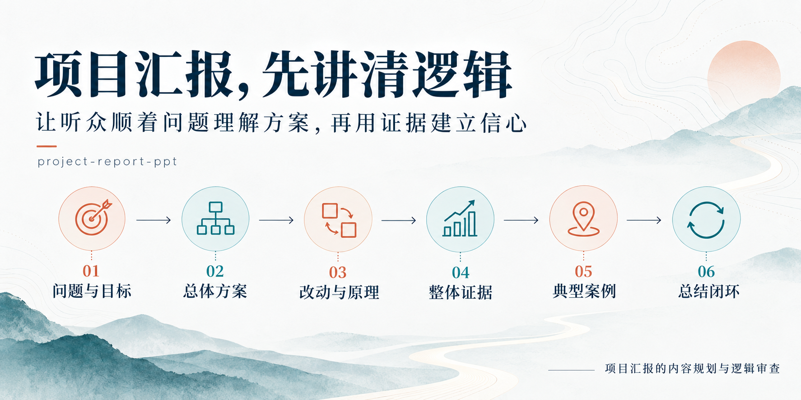

<div align="center">

# project-report-ppt

**项目汇报，先讲清逻辑。**

让 AI 按听众的理解顺序组织项目汇报，把业务目标、方案、原理和结果接成一条清楚的线。

[](LICENSE)
[](SKILL.md)
[](#什么时候用)



</div>

## 它解决什么问题：使用前与使用后

AI 可以生成完整的页面，但项目的目标、方法、证据和结论仍可能没有接起来。这个 Skill 把“让人看懂这项项目”转化为明确的内容组织规则。

下表展示典型编排问题与使用后的目标效果，属于示意对照，并非同题实测或模型排名。

| 看哪里 | 没有这套 Skill 引导时，AI 容易做出的 PPT | 使用 `project-report-ppt` 后的组织方式 |
| --- | --- | --- |
| 开场 | 从行业背景、名词和数据清单开始，迟迟没说项目要解决什么 | 先交代业务位置、具体问题和成功标准 |
| 方案 | 罗列输入、算法和输出，听众仍看不出它们怎样连起来 | 先给完整模型与清楚的边界，再定位内部模块 |
| 新旧变化 | 连续介绍几种算法，让领导自行猜测替换与新增关系 | 先并排对照原流程与新流程，明确改在哪里 |
| 为什么选 | 用“测试了很多方法，这个分数更高”代替设计理由 | 从任务特征、算法原理和同行依据论证，再用实验验证 |
| 原理深度 | 公式、参数和实现步骤很多，项目主线被淹没 | 讲到足以理解选择与运行，细节按需要收进备用材料 |
| 实验结果 | 地图、指标和结论逐页排列，彼此缺少解释 | 先说评价标准，再从整体到局部，把现象与机制连起来 |
| 案例 | 每例换一种版式，指标位置和比较顺序也变化 | 同类案例保持统一模板，方便直接比较 |
| 总结 | 重复“先进、高效、智能”等优点 | 用证据逐项回答开头的项目目标 |

### 同一个任务，讲述顺序怎样变化

以“向甲方汇报一项方法改进”为例，下面只演示内容安排：

```text
缺少叙事约束时的常见编排
背景 → 数据介绍 → 算法A → 算法B → 算法C → 指标表 → 几个案例 → 优点总结

使用这个 Skill 的编排
业务问题与目标 → 完整方案 → 新旧改动 → 原理与选型依据
→ 评价标准 → 整体证据 → 统一模板的典型案例 → 逐项回答目标
```

前后差别可以直接检查：听众是否更早知道项目要解决什么，能否认清方案改动，后面的证据是否回答了前面的问题。

## 什么时候用

适合面向甲方、领导和非技术决策者的**项目成果汇报、方法改进汇报、项目验收及方案汇报**，尤其是这些情况：

| 你的情况 | 这个 Skill 帮你做什么 |
| --- | --- |
| 材料很多，整套 PPT 的顺序却讲不顺 | 围绕听众的问题重组章节与页序 |
| 技术方法讲了很多，领导仍看不懂改在哪里 | 先呈现完整方案和新旧对照，再解释关键机制 |
| 结果图、指标、案例都有，彼此联系不清楚 | 建立“原理预期—实际现象—量化验证—具体案例”的联系 |
| 每页都很满，案例页又总换布局 | 安排信息密度起伏，为同类案例建立稳定模板 |
| 结尾只有几句优点，接不回项目目标 | 让总结逐项回答开头提出的需求 |

重点是项目汇报的**内容组织与逻辑审查**。具体页面设计、图像生成、PPTX 编辑和渲染，可配合你已有的制作 Skill 或工具完成。

## 它遵循什么逻辑

```text
为什么做
   ↓
提出什么完整方案
   ↓
相对原方案改了什么，为什么这样改、怎样运行
   ↓
整体实验是否支持：先评价标准，再看图与数
   ↓
落到一个熟悉的具体案例，改善了多少
   ↓
最初的项目目标分别完成到什么程度
```

这是一种可调整的认识顺序，不要求所有项目套用相同章节、页数或风格。

### 几条关键判断

- **先整体、再拆解、再回扣。** 总图三次出现分别承担认识组成、理解原理、整合方法的作用。
- **项目汇报把握技术深度。** 原理讲到能理解方案和选择理由；没有页数上限，也不把它展开成技术培训。
- **选型理由与实验验证分工明确。** 任务特征、原理和同行应用说明为何采用，项目实验检验实际效果；证据不足时不预写强结论。
- **箭头表达真实关系。** 输入、模型边界、训练、已训练模型、推理和结果连接清楚。
- **先全局、后案例。** 整体结果建立认识，再用具体对象解释价值。
- **同类案例保持一致。** 固定图、指标、单位和结论的位置，减少反复寻找信息的负担。
- **效率对应真实业务。** 比较完成一次业务的总用时，明确起止边界。

## 安装

将本仓库放到 Codex 的技能目录。默认位置是 `~/.codex/skills/project-report-ppt`；如果设置了 `CODEX_HOME`，使用其下的 `skills` 目录。

```bash
git clone https://github.com/SCAU-Algae/project-report-ppt.git ~/.codex/skills/project-report-ppt
```

也可以下载 ZIP，解压后将文件夹重命名为 `project-report-ppt`，放入技能目录。确保目录中直接包含 `SKILL.md`，不要多套一层同名目录。Windows 默认目录为 `%USERPROFILE%\.codex\skills\project-report-ppt`。

技能可被识别后，在任务中直接使用 `$project-report-ppt`；已有会话未识别到新技能时，可在新会话中调用。

## 使用示例

**规划项目汇报：**

```text
请使用 $project-report-ppt，根据我提供的项目材料规划一份面向甲方领导的成果汇报。
先说明每个章节要回答的问题，再给出逐页表达重心和证据安排。
这是项目汇报，原理不要拆得过细。
```

**审查现有 PPT：**

```text
请使用 $project-report-ppt，审查这份PPT的逻辑链。
指出哪些页需要移动、合并或补充，检查选型依据、实验结果与案例之间是否衔接。
先给修改建议，暂时不要改文件。
```

**配合已有制作 Skill：**

```text
请用 $project-report-ppt 组织汇报逻辑，再用我指定的PPT制作Skill完成页面。
保留当前确认的视觉风格；同类案例使用统一模板。
```

## 仓库内容

```text
project-report-ppt/
├── SKILL.md                       核心指引
├── agents/openai.yaml             Codex 展示与调用信息
├── references/report-example.md   通用编排示例
├── assets/                       README 配图与生成说明
└── LICENSE                        MIT 开源许可
```

公开示例只演示编排方法，不包含客户数据、项目结果或本地路径。

## 反馈与支持

欢迎通过 Issues 提供匿名化的使用场景、逻辑问题和改进建议。

**如果试用后觉得它帮你把项目讲得更清楚，欢迎点一个 ⭐ Star，让更多需要做项目汇报的人找到它。**

## License

[MIT](LICENSE) · 可自由使用、修改与分发，保留许可声明。

---

**English:** A Codex skill for planning and reviewing client-facing project presentations. It connects business goals, solution architecture, method rationale, global evidence, concrete cases and a closing response to the original goals. It guides narrative and content depth, and works alongside your slide-authoring tools.
